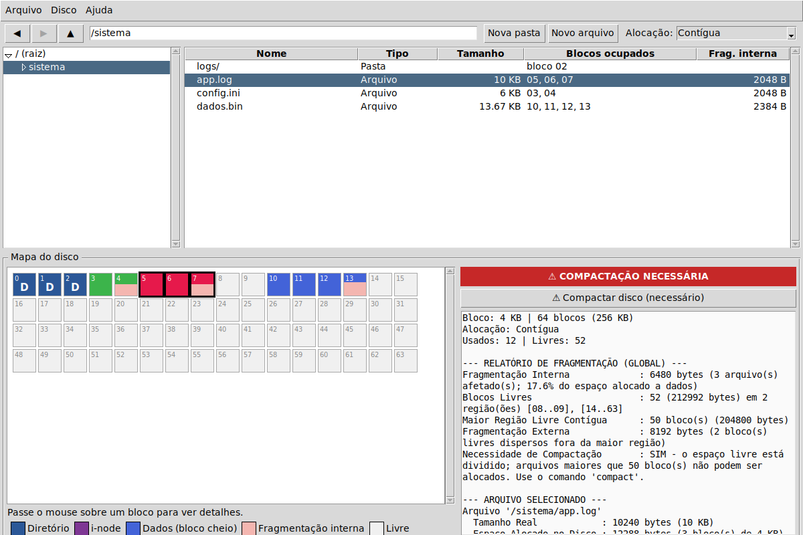

# Simulador de Sistema Operacional Modular

Projeto em etapas incrementais. Inclui o sistema de arquivos da **Etapa 1**, o gerenciamento de armazenamento da **Etapa 2** e os controles de segurança da **Etapa 3**.

- **Linguagem:** Python 3.9+ com `cryptography` para criptografia autenticada.
- **Interfaces:** shell interativo (REPL), scripts de comandos e **interface gráfica (Tkinter) estilo Windows Explorer**

## Como executar

```bash
git clone <URL-DO-SEU-REPOSITORIO>
cd os-simulator
python -m pip install -r requirements.txt

python main.py                                   # shell interativo (disco de 16 x 4 KB, indexado)
python main.py --alloc contiguous --block-size 1KB --blocks 32
python main.py --script examples/01_enunciado_indexada.txt   # roda um script de demonstração
```

Testes (opcional): `pip install -r requirements-dev.txt && pytest` (os testes da GUI são pulados se não houver display)

## Interface gráfica

```bash
python gui.py                                    # disco de 64 x 4 KB, alocação indexada
python gui.py --alloc contiguous --block-size 1KB --blocks 128
```



- **Esquerda:** árvore de pastas. **Direita:** conteúdo da pasta (tipo, tamanho, blocos ocupados, fragmentação interna).
- **Barra de endereço** (caminhos absolutos e relativos), botões voltar/avançar/subir.
- **Botão direito:** abrir, renomear (F2), excluir (Del), propriedades, nova pasta/arquivo. Duplo clique abre pasta ou editor de texto.
- **Mapa do disco:** um quadrado por bloco, uma cor por arquivo. Blocos parcialmente preenchidos mostram em rosa a parte desperdiçada (fragmentação interna). Passe o mouse para ver o detalhe do bloco; clique para selecionar o arquivo dono.
- **Painel de diagnóstico:** fragmentação interna/externa e faixa vermelha **COMPACTAÇÃO NECESSÁRIA** (com botão para compactar).
- **Alocação** trocável na barra superior (migra os arquivos); *Disco > Formatar* recria o disco com outro tamanho de bloco.

> Tkinter vem com o Python no Windows e no macOS. No Linux: `sudo apt install python3-tk`.

## O que a Etapa 1 implementa

| Requisito | Implementação |
|---|---|
| Hierarquia em árvore | `osim/filesystem.py` - nós `Node` (diretório/arquivo), diretório corrente, caminhos absolutos (`/a/b`) e relativos (`a/b`, `./a`, `../a`) |
| CRUD | `mkdir`, `create`, `cat`, `write`, `append`, `resize`, `mv`, `cp`, `rm`, `rmdir` |
| Camada física em blocos | `osim/disk.py` - disco com blocos de tamanho fixo (configurável: 512 B, 1 KB, 4 KB...) |
| Estratégias de alocação | `osim/allocation.py` - **as três**: Contígua (first-fit), Encadeada (FAT) e Indexada (i-node), via *Strategy Pattern* |
| Mapa gráfico do disco | `fs_status` - grade de blocos com cores/símbolos por arquivo + lista bloco a bloco com `--details` |
| Fragmentação interna | por arquivo e total (bytes e % de desperdício no último bloco) |
| Fragmentação externa | regiões livres, maior região contígua, bytes "presos" fora da maior região |
| Necessidade de compactação | indicação explícita SIM/NÃO com justificativa; comando `compact` resolve |

### Extras

- `set_alloc <estratégia>` migra o disco inteiro para outra estratégia sem perder dados.
- `compact` reorganiza o disco (atômico: em caso de erro, restaura o estado anterior).
- Atualizações que não cabem fazem *rollback* e preservam o arquivo original.
- Limite de i-node realista: `tamanho_do_bloco / 4` ponteiros por arquivo.

## Modelo de disco

- Cada **diretório** ocupa 1 bloco de metadados (`DIR_RAIZ`/`DIR`; `INODE_RAIZ`/`INODE_DIR` no modo indexado).
- **Indexada:** cada arquivo ocupa 1 bloco de i-node (`INODE_ARQ`) + blocos de dados.
- **Encadeada:** só blocos de dados; cada um indica o próximo (`-> próximo: NN`, `-> FIM`).
- **Contígua:** só blocos de dados, sempre consecutivos (a primeira região livre que couber).
- Arquivos criados com `--size` são preenchidos com zeros; o `cat` os exibe como conteúdo binário.

## Comandos

```
pwd | cd <dir> | ls [-l] [caminho] | tree [caminho] | stat <caminho>
mkdir [-p] <dir> | create <arq> [--size 10KB] [--content "texto"]
cat <arq> | write <arq> <texto> | append <arq> <texto> | resize <arq> <tamanho>
mv <origem> <destino> | cp <origem> <destino> | rm [-r] <caminho> | rmdir <dir>
fs_status [--details] | compact | set_alloc <contiguous|linked|indexed>
format [--block-size 4KB] [--blocks 16] [--alloc indexed]
help | exit
```

## Exemplo (alocação indexada, saída real do simulador)

```
/> mkdir /sistema
/> mkdir /sistema/logs
/> create /sistema/logs/app.log --size 10KB
/> tree
/
└── sistema/ [DIR]
    └── logs/ [DIR]
        └── app.log (10 KB) [ARQ]

/> fs_status --details
Tamanho do Bloco de Disco: 4 KB | Total de Blocos: 16 (64 KB)
Estratégia de Alocação   : Indexada (i-node)

[MAPA GRÁFICO DO DISCO]
00 | [#][#][#][@][A][A](A) .  .  .  .  .  .  .  .  .
Legenda: [#] diretório | [@] i-node | [X] bloco cheio | (X) bloco parcial = fragmentação interna | . livre

[MAPA DE ALOCAÇÃO DO DISCO - Indexada (i-node)]
Bloco 00 [INODE_RAIZ]   : Diretório '/'
Bloco 01 [INODE_DIR]    : Diretório '/sistema'
Bloco 02 [INODE_DIR]    : Diretório '/sistema/logs'
Bloco 03 [INODE_ARQ]    : Arquivo '/sistema/logs/app.log' (índice -> blocos: 04, 05, 06)
Bloco 04 [DADO]         : '/sistema/logs/app.log' (Bloco 1 - 4096 bytes ocupados)
Bloco 05 [DADO]         : '/sistema/logs/app.log' (Bloco 2 - 4096 bytes ocupados)
Bloco 06 [DADO]         : '/sistema/logs/app.log' (Bloco 3 - 2048 bytes ocupados)
Bloco 07..15            : [LIVRE]

--- RELATÓRIO DE FRAGMENTAÇÃO (GLOBAL) ---
Fragmentação Interna             : 2048 bytes (1 arquivo(s) afetado(s); 16.7% do espaço alocado a dados)
Fragmentação Externa             : 0 bytes (não se aplica: alocação não-contígua)
Necessidade de Compactação       : NÃO (alocação não-contígua não exige blocos adjacentes)
```

## Exemplo (alocação contígua com fragmentação externa)

Rode `python main.py --script examples/02_contigua_fragmentacao.txt`. Após remover um arquivo do meio, o relatório mostra:

```
[MAPA GRÁFICO DO DISCO]
00 | [#][A][A][A] .  .  . [B][B][C](C) .  .  .  .  .

Blocos Livres                    : 8 (8192 bytes) em 2 região(ões) [04..06], [11..15]
Maior Região Livre Contígua      : 5 bloco(s) (5120 bytes)
Fragmentação Externa             : 3072 bytes (3 bloco(s) livres dispersos fora da maior região)
Necessidade de Compactação       : SIM - o espaço livre está dividido; arquivos maiores que 5 bloco(s) não podem ser alocados. Use o comando 'compact'.

/> create /grande.dat --size 6KB
Erro: fragmentação externa: há 8 blocos livres, mas a maior região contígua tem só 5 (necessário: 6). Execute 'compact' ...
/> compact
/> create /grande.dat --size 6KB       # agora cabe
```

## Estrutura do repositório

```
os-simulator/
├── main.py                 # ponto de entrada (CLI / REPL / scripts)
├── gui.py                  # ponto de entrada da interface gráfica
├── docs/gui.png
├── osim/
│   ├── disk.py             # camada física: blocos, donos, regiões livres
│   ├── allocation.py       # Contígua / Encadeada (FAT) / Indexada (i-node)
│   ├── filesystem.py       # árvore, caminhos, CRUD, compactação, migração
│   ├── report.py           # mapa gráfico, fragmentação, compactação
│   ├── shell.py            # interpretador de comandos
│   ├── gui.py              # interface gráfica (Tkinter)
│   └── utils.py            # parse/format de tamanhos
├── examples/               # scripts de demonstração
└── tests/                  # test_filesystem.py, test_gui.py
```

## Próximas etapas

A separação em módulos (`Disk` -> `AllocationStrategy` -> `FileSystem` -> `Shell`) permite adicionar as etapas seguintes sem reescrever o sistema de arquivos.

## Etapa 2 — Gerenciamento de armazenamento

A árvore de arquivos e as estratégias Contígua, Encadeada e Indexada continuam sobre o mesmo `Disk` lógico. Abaixo dele, `osim/storage.py` implementa dispositivos físicos e `osim/scheduling.py` implementa as políticas de escalonamento.

```text
Shell / GUI -> FileSystem -> AllocationStrategy -> Disk lógico
                                                   |
                                          HDD / SSD / RAIDArray
                                                   |
                                     filas de E/S dos discos físicos
```

### Executar e demonstrar

```bash
python main.py --script examples/04_escalonamento.txt --blocks 200
python main.py --script examples/05_raid5.txt
python main.py --script examples/06_ssd.txt

python main.py --device hdd --scheduler scan --head 53 --tracks 200 --direction up
python main.py --device raid --raid-level 5 --disks 3 --blocks 32
python gui.py --device ssd
```

As opções `--device`, `--raid-level`, `--disks`, `--scheduler`, `--head`, `--tracks` e `--direction` estão disponíveis nos dois pontos de entrada. Na GUI, use **Disco > Armazenamento, E/S e RAID...** para migrar os arquivos, consultar/atender filas, demonstrar os algoritmos, falhar discos e reconstruí-los. O painel de diagnóstico também mostra dispositivo e número de requisições pendentes.

### Integração real com as operações de arquivo

`create`, `write`, `write_file`, `append`, `resize`, `cp`, `cat` e `read_file` passam pelo dispositivo físico. Cada bloco de conteúdo gera E/S; i-nodes e diretórios geram escritas de metadados (reservados, sem serialização de uma estrutura binária). Leituras de arquivos indexados também consultam seu i-node. A fila identifica operação, bloco físico e caminho do arquivo. Em HDD, a trilha é `bloco físico % número de trilhas`, uma geometria didática explícita, com uma cabeça independente por disco RAID.

```text
mkdir -p /sistema/logs
write_file /sistema/logs/app.log "Novo Registro"
io_status
io_flush
read_file /sistema/logs/app.log
```

As escritas ficam na fila até o atendimento. `io_flush` executa as operações na ordem da política escolhida e soma o deslocamento da cabeça. Leituras atendem as escritas anteriores antes de devolver bytes; escritas repetidas no mesmo endereço também criam uma barreira para preservar a ordem dos dados. Checkpoints transacionais e operações RAID de leitura/modificação/escrita podem atender a fila automaticamente. `io_status` mostra pendências, último percurso e as dez operações mais recentes por dispositivo; `storage_status` atende as filas e mostra o estado físico. A saída do programa atende as escritas restantes.

`disk_config` migra os arquivos existentes entre HDD, SSD e RAID sem alterar seus blocos lógicos. Falhas de alocação ou de migração preservam o estado anterior. Compactação e troca de estratégia incluem o armazenamento físico no rollback. `format`, no shell e na GUI, apaga os arquivos e recria um HDD; use `disk_config` para selecionar outro dispositivo após formatar.

### Escalonamento do braço

Políticas implementadas com Strategy Pattern: **FCFS**, **SSTF**, **SCAN** e **C-SCAN**. SSTF desempata pela ordem de chegada. SCAN/C-SCAN aceitam direção `up` ou `down`; trilhas válidas vão de zero a `--tracks - 1`. O percurso inclui o extremo quando necessário para alcançar pedidos do outro lado. C-SCAN contabiliza também o movimento de retorno entre extremos. O atendimento para quando a última requisição é concluída, sem deslocamento ocioso adicional.

`disk_schedule` demonstra uma fila independente; use `disk_config hdd --algorithm ...` para escolher a política da E/S real.

```text
disk_schedule 98 183 37 122 14 --head 53 --algorithm sstf
```

```text
--- ESCALONAMENTO DE DISCO: SSTF ---
Ordem de Atendimento : 53 -> 37 -> 14 -> 98 -> 122 -> 183
Deslocamento da Cabeça: |53-37| + |37-14| + |14-98| + |98-122| + |122-183|
Total de Movimento  : 16 + 23 + 84 + 24 + 61 = 208 trilhas
```

### SSD: páginas, coleta de lixo e desgaste

`disk_config ssd` habilita uma FTL: um bloco lógico corresponde a uma página, e cada bloco de apagamento contém quatro páginas. As atualizações usam escrita fora do lugar: a página anterior fica inválida e o mapeamento passa a apontar para uma página física nova. O wear leveling dinâmico prioriza blocos menos apagados e páginas menos programadas. A coleta de lixo copia páginas válidas antes de apagar o bloco escolhido. A reserva física é de 100% da capacidade lógica, arredondada para blocos de apagamento, mais um bloco de reserva.

`storage_status` exibe mapeamento lógico/físico, programações por página, apagamentos por bloco e quantidade de coletas de lixo. O atendimento usa FCFS e o deslocamento é zero, pois não existe braço mecânico. O modelo não simula tempo elétrico, limite de vida útil nem wear leveling estático de dados frios. O exemplo `06_ssd.txt` permite acompanhar a troca de páginas e a coleta de lixo ao sobrescrever o mesmo arquivo.

### RAID: distribuição, falha e reconstrução

| Nível | Discos mínimos | Distribuição | Tolerância |
|---|---:|---|---|
| RAID 0 | 2 | Striping de dados | Nenhuma falha |
| RAID 1 | 2 | Cópia completa em cada membro | Todos menos um membro |
| RAID 4 | 3 | Dados em stripes; último disco guarda paridade XOR | Uma falha |
| RAID 5 | 3 | Dados em stripes; paridade XOR rotativa | Uma falha |

Cada unidade de stripe tem um bloco lógico. `--blocks` indica a capacidade **lógica útil**; os discos físicos são dimensionados conforme o nível. Uma stripe final incompleta usa zeros nas posições sem dados. No RAID 5, a paridade começa no último disco e gira para trás a cada stripe. Metadados e conteúdos usam o mesmo arranjo, portanto um arquivo pode começar no meio de uma stripe ou atravessar várias delas.

```text
disk_config raid --level 5 --disks 3
mkdir /dados
write_file /dados/planilha.csv --size 8KB
storage_status
fail_disk 2
read_file /dados/planilha.csv
rebuild_disk 2
```

RAID 4/5 calcula a paridade **sobre bytes reais**, não somente rótulos: `paridade = XOR(dados)`. A atualização usa leitura/modificação/escrita; com um disco falho, o arranjo continua lendo e gravando. Um bloco ausente é recuperado por `XOR` dos demais membros da stripe; `storage_status` registra as recuperações. `rebuild_disk` reconstrói todos os blocos em um substituto e só o ativa quando termina. RAID 1 lê de um espelho saudável e o usa para reconstrução. RAID 0 recusa operações após falha; RAID 4/5 recusa operações com duas falhas.

`--size 8KB` preenche o conteúdo com zeros, como na Etapa 1. O exemplo `05_raid5.txt` inclui também texto não zerado e uma atualização durante a falha. Os testes removem os bytes do membro falho para verificar que a recuperação usa os outros discos. Toda a simulação permanece em memória, sem persistência entre execuções.

### Testes da Etapa 2

```bash
python -m pip install -r requirements-dev.txt
python -m pytest -q
```

`tests/test_storage.py` cobre o resultado SSTF de 208 trilhas, as quatro políticas e seus extremos, despacho efetivo da fila, dependências de leitura/escrita, integração com as três alocações, paridade, falha de cada membro, escrita degradada, reconstrução, tolerância excedida, rollback, migração e preservação de dados durante coleta de lixo do SSD. `tests/test_gui.py` também cobre os controles de SSD/RAID e a janela de armazenamento, quando há display.

## Etapa 3 — Identidade, proteção de dados e integridade

```bash
python main.py --script examples/07_seguranca.txt
```

O exemplo cria o grupo `devs` e o usuário `carlos`, demonstra o bloqueio de leitura de um arquivo `750`, grava um arquivo criptografado e executa a varredura após uma alteração simulada. As credenciais do exemplo são fictícias.

### Sessões e permissões

Cada simulação inicia em `MODO_KERNEL` como `root` para permitir a configuração do disco e a execução dos exemplos anteriores. Use `passwd root` antes de trocar de usuário para poder retornar ao modo kernel com a senha escolhida. `logout` encerra a sessão e o acesso ao sistema de arquivos até o próximo `login`. Usuários, grupos, ACLs, hashes de integridade e logs fazem parte do estado em memória da simulação. A formatação preserva as contas e a auditoria da sessão.

| Comando | Efeito |
|---|---|
| `groupadd devs` e `useradd carlos --group devs` | Cadastram grupo e usuário. O cadastro solicita a senha em entrada oculta. |
| `login --user carlos`, `whoami`, `logout` | Autentica, mostra identidade e modo ou encerra a sessão. |
| `passwd [usuário]` e `usermod carlos --group devs` | Define senha ou adiciona associação a um grupo. |
| `chmod 750 /sistema/config.sys` | Define permissões em octal. Também aceita `rwxr-x---`. |
| `chown carlos:devs /home/carlos` | Transfere propriedade a um usuário e grupo cadastrados. |
| `exec_file <arquivo>` | Verifica a permissão de execução simulada. |
| `audit_log` | Exibe eventos de autenticação, acessos negados, ações administrativas e alertas. |

Arquivos novos recebem modo `644` e diretórios recebem `755`. O proprietário é o usuário que cria o objeto e o grupo é seu grupo principal. A verificação usa a classe de proprietário, de grupo (principal ou suplementar) ou de outros. Diretórios exigem `x` para travessia, `rx` para listagem e `wx` para alterações nas entradas. A remoção recursiva também verifica as permissões nos diretórios do ramo. O proprietário ou root pode usar `chmod`. Os comandos administrativos de usuários, armazenamento, RAID, formatação, compactação, auditoria e varredura exigem `MODO_KERNEL`. Senhas são verificadas por PBKDF2-HMAC-SHA256 com 600.000 iterações e salt individual aleatório.

### Criptografia e auditoria

- `encrypt_file <arquivo>` solicita a chave e grava o conteúdo com AES-256-GCM. `decrypt_file <arquivo>` restaura a forma legível com a chave correta. `create` e `write_file` aceitam `--ask-key` para criar um arquivo já criptografado.
- Use `read_file <arquivo> --ask-key` para leitura. `write`, `write_file`, `append` e `resize` aceitam a mesma opção para gravar com criptografia ou atualizar um arquivo já criptografado. O conteúdo físico inclui 16 bytes de autenticação, contabilizados na alocação. A derivação da chave usa salt por arquivo e as regravações usam nonce novo. A chave de acesso é informada a cada operação.
- `antivirus_scan /` compara os hashes SHA-256 registrados na gravação com os blocos lidos do dispositivo, incluindo o preenchimento. Verifica também os metadados físicos e, quando há discos suficientes para comparação, a consistência de espelhos e paridade nas stripes inspecionadas. Em texto legível procura assinaturas de teste. Para arquivos criptografados, a varredura verifica a integridade do conteúdo cifrado.
- `corrupt_block <arquivo> [índice]` altera um bloco sem atualizar seu registro de integridade. O comando permite demonstrar o alerta sem modificar arquivos do computador.

Os argumentos `--password` e `--key` permitem automatizar exemplos com credenciais fictícias. Prefira a entrada oculta ao usar uma senha ou chave pessoal. A criptografia protege o conteúdo gravado no dispositivo simulado. Converter um arquivo existente não é uma operação de apagamento seguro das páginas antigas de um SSD.

Na GUI, o menu **Segurança** oferece autenticação, cadastro, ACL, criptografia, varredura e auditoria. Selecione um arquivo para alterar permissões ou criptografia. Ao abrir um arquivo criptografado, informe a chave no diálogo.
